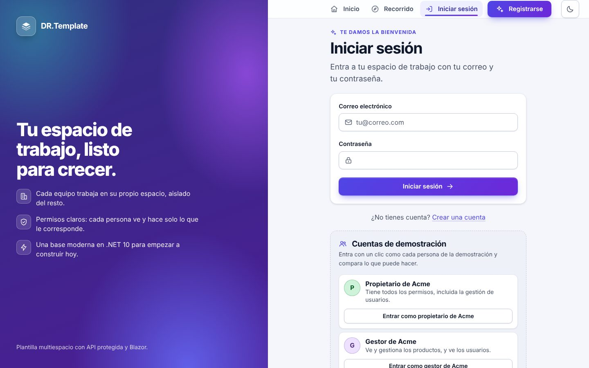
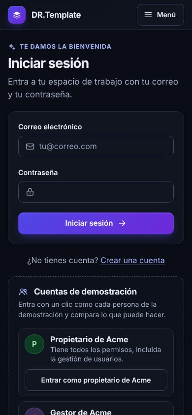
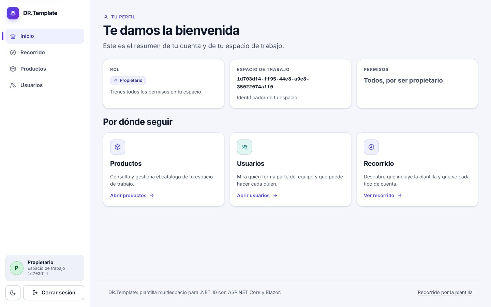
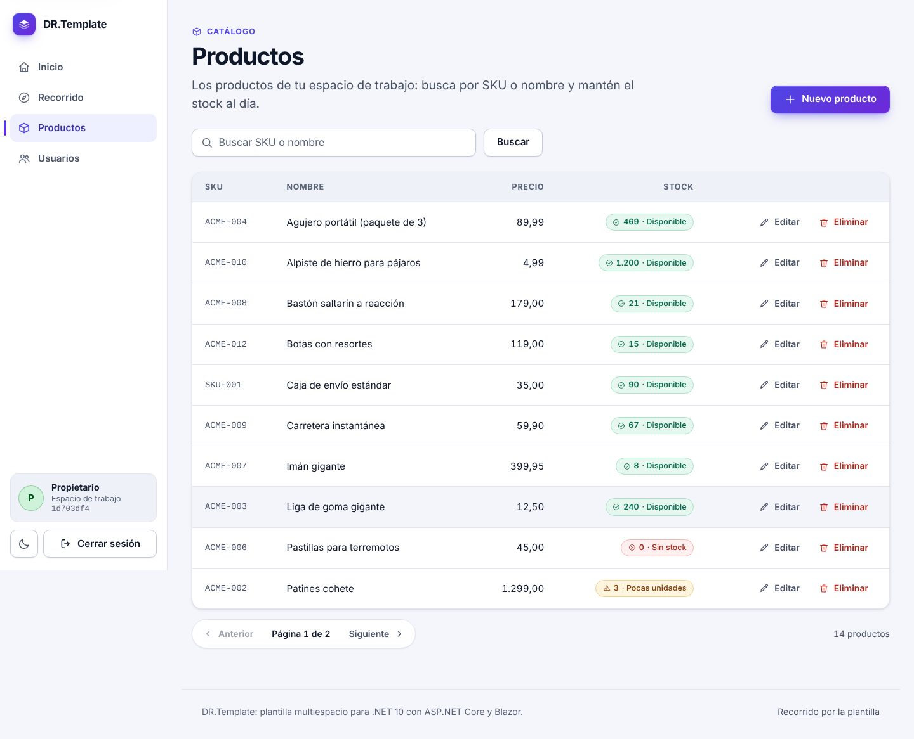
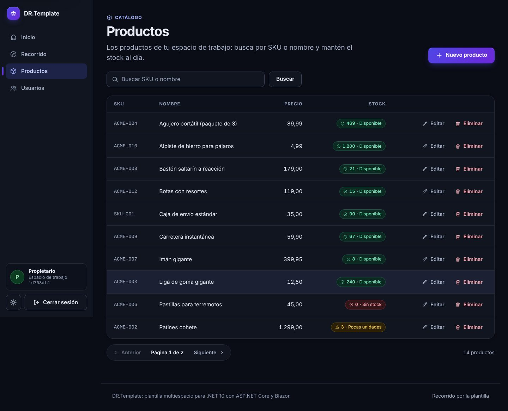
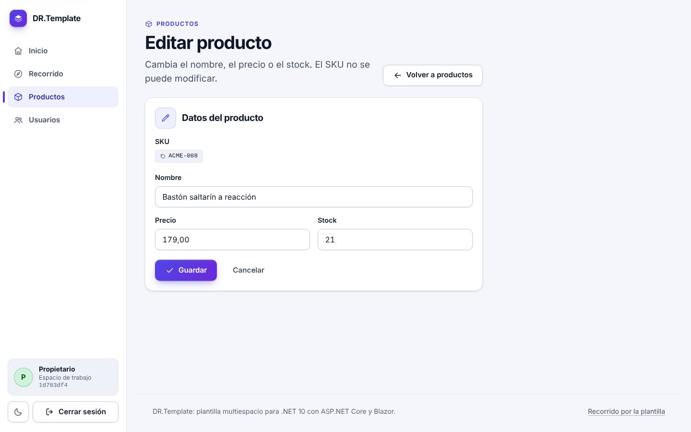
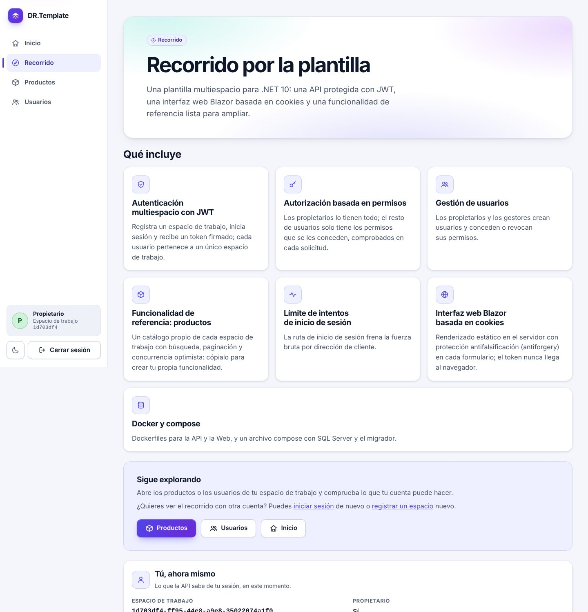
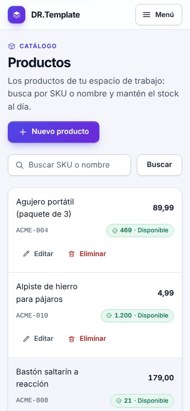

# Conversia

Clean Architecture template for custom .NET systems. Ships with a
working Users / Tenants / Permissions foundation so a new client project
starts from a tested base instead of rebuilding auth from scratch.

## Try the demo

With Docker Compose (v2) and nothing else installed:

```bash
cp .env.example .env     # set JWT_SIGNING_KEY (openssl rand -base64 48); the sample POSTGRES_PASSWORD is fine locally
docker compose -f docker-compose.yml -f docker-compose.demo.yml up --build
# then open http://localhost:5112 and click "Entrar como lector de Acme"
```

The overlay seeds two tenants, five accounts with different permissions and a
product catalog. How to present it, the accounts and a scene-by-scene script:
[`docs/DEMO.md`](docs/DEMO.md). How to build your own feature the same way
(and how to remove the demo): [`docs/EXTENDING.md`](docs/EXTENDING.md). The demo
is for your own machine only: its accounts have a publicly known password.

## Features

- **A modern, accessible UI** — the Blazor Web has its own design system
  (indigo-to-violet palette, light and dark themes, app shell with sidebar,
  responsive down to 360 px, no Bootstrap, no web fonts, no external requests;
  current Chrome/Edge 86+, Firefox 85+ and Safari 15.4+, with plain fallbacks for
  `color-mix()`, `oklch()` and `dvh`, see
  [Supported browsers](docs/EXTENDING.md#supported-browsers)).
  See [Screenshots](#screenshots) and
  [Using the design system](docs/EXTENDING.md#using-the-design-system).
- **Spanish UI and messages** — the user interface and every message the
  API returns to users or clients (problem details, validation messages) are in
  Spanish; code, logs, configuration keys, routes and JSON property names stay
  in English. The culture is fixed to `es` (see
  [Translating / changing the UI language](docs/EXTENDING.md#translating--changing-the-ui-language)).
- **Tenant registration and login** — `register-tenant` creates a tenant
  and its owner in one transaction and signs the owner in; `login` is
  email + password (email is globally unique).
- **JWT bearer authentication** — HS256 token valid for 8 hours with
  `sub`, `tenant_id` and `is_owner` claims. The API refuses to start
  with a missing, short (< 32 bytes) or placeholder signing key.
- **Permission-based authorization** — one policy per `Permission` enum
  value (`UsersView`, `UsersManage`, `ProductsView`, `ProductsManage`,
  `OrganizationView`, `OrganizationManage`, `ConversationsView`, `ConversationsManage`, `MetricsView`);
  owners bypass checks inside their own tenant. Permissions are read from the database on every request,
  so a revoke applies immediately.
- **User creation and permission grant/revoke** — owners and
  `UsersManage` holders create users in their own tenant and grant or
  revoke permissions.
- **Multi-tenancy** — EF Core global query filters on every
  tenant-scoped table.
- **Reference feature: Products** — a tenant-scoped catalog (per-tenant
  unique SKU, search, paging) with optimistic concurrency (`rowVersion`, backed by
  PostgreSQL's `xmin`; `409` on a stale write) across every layer; copy it to build your own
  feature (`docs/EXTENDING.md`).
- **Error registry** — every unexpected API error gets a unique code
  (`ERR-20261018-7K3M9Q`) that is stored with its context in `ErrorLogs`,
  logged, and returned to the client (`errorId` + `X-Error-Id`) so a user can
  quote it; secrets are redacted, repeats are throttled, old rows are purged
  (`docs/ERRORS.md`).
- **Opt-in demo** — `Demo:Enabled` (API) seeds two tenants, five accounts
  and sample products; `Demo:ShowAccounts` (Web) adds sign-in shortcuts and a
  scripted tour. Both are rejected outside the `Development` and `Demo`
  environments.
- **Password policy** — 12-128 characters with an uppercase letter, a
  lowercase letter and a digit (registration and user creation).
- **Login rate limiting** — fixed window per client IP on
  `POST /api/auth/login`, `429` + `Retry-After` when exceeded.
- **Blazor UI** (`Conversia.Web`) — static server-side rendering with
  cookie authentication: landing page, `/login`, `/register`,
  `/panel` (the executive dashboard, where people land after signing in: six headline
  numbers, alerts, breakdowns by branch, advisor and source, loss reasons, volume by day
  and a day-by-hour heat map, all drawn with inline SVG/CSS and driven by the query string,
  `docs/METRICS.md`),
  `/conversaciones` (the chats: filterable list with masked numbers, and a detail with the
  chat thread, the classifier's reading and, for `ConversationsManage`, advisor assignment and
  a manual outcome),
  `/users` (user list, create user, grant/revoke permissions),
  `/products` (the reference feature: list, search, create, edit, delete;
  prices are shown the Spanish way, `1.234,50`, and typed with a comma or a dot)
  and `/demo` (a public tour of the template). The API's JWT lives only
  inside the encrypted HttpOnly auth cookie.
- **Consistent errors** — every error is `application/problem+json`; an
  unhandled exception is a `500` with no stack trace or message.
- **Docker** — Dockerfiles for API and Web, a `docker-compose.yml` with
  PostgreSQL and a one-shot migrations job, a `docker-compose.demo.yml`
  overlay that boots the demo, and a rename script for starting a client
  project.

## Screenshots

The Web UI is in Spanish, with a light and a dark theme (it follows the system
setting; a button in the shell overrides it) and a layout that works down to
360 px.

| | |
|---|---|
|  |  |
| *Inicio de sesión (tema claro) y en un teléfono (tema oscuro)* | |













## Stack

- .NET 10 (LTS)
- ASP.NET Core Web API (Controllers) + Blazor Web App (static server-side
  rendering, cookie sign-in) as the front end
- EF Core 10 + PostgreSQL 17 (Npgsql)
- xUnit, Moq (unit tests), Testcontainers.PostgreSql (integration tests —
  real PostgreSQL in Docker, spun up and torn down per test run)
- GitHub Actions (`.github/workflows/tests.yml`) builds the solution and
  runs all five test projects on every push/PR to `main`

## Solution layout

```
src/
  Conversia.Domain          entities, enums, domain interfaces — no dependencies
  Conversia.Application     use-case services, DTOs, validation — depends on Domain
  Conversia.Infrastructure  EF Core, repositories, JWT, auth handler — depends on Domain + Application
  Conversia.API             ASP.NET Core Web API — depends on all three
  Conversia.Web             Blazor front end — depends on Application only, talks to the API over HTTP
tests/
  Conversia.Domain.UnitTests
  Conversia.Application.UnitTests
  Conversia.Infrastructure.UnitTests   permission authorization handler
  Conversia.IntegrationTests           the API against real PostgreSQL (Testcontainers)
  Conversia.Web.IntegrationTests       the Web against the real API + PostgreSQL (Testcontainers)
docs/                                    ARCHITECTURE, WORKFLOW, USERS_TENANTS_PERMISSIONS, DEMO, EXTENDING, ERRORS
scripts/rename.sh                        rename the template for a new project
docker-compose.yml, .env.example         full local stack
docker-compose.demo.yml                  overlay: the same stack with the demo data and accounts
```

Read `docs/ARCHITECTURE.md` before adding anything — it defines the
dependency direction and per-layer conventions this template enforces.

## Quick start with Docker Compose

Prerequisite: Docker with Compose v2. Nothing else is needed — no .NET SDK.

```bash
cp .env.example .env     # then edit the required secrets
docker compose up -d --build
```

- `POSTGRES_DB`, `POSTGRES_USER`, `POSTGRES_PASSWORD` — database, user and
  password of the PostgreSQL container; the API and the migrator get the
  same values in their connection string. Avoid `;`, `=` and `"` in the
  password.
- `JWT_SIGNING_KEY` — at least 32 bytes (`openssl rand -base64 48`).
- Compose fails immediately with a message if any of them is missing. `.env`
  is git-ignored.

Services: `postgres` (`postgres:17-alpine`, with a `pg_isready` healthcheck
and the `postgres-data` volume), `migrator` (one-shot job that applies the EF Core migrations
through a migrations bundle and exits), `api` and `web`. The API and Web
start only after the migrator completed successfully.

| What | URL |
|---|---|
| Web | http://localhost:5112 |
| API | http://localhost:5030 |
| PostgreSQL | `127.0.0.1:5432` (`POSTGRES_USER` / `POSTGRES_PASSWORD`) |

Host ports can be changed with `WEB_PORT`, `API_PORT` and `POSTGRES_PORT` in
`.env`. Open the Web, register a workspace and sign in. Stop with
`docker compose down`; add `-v` to also delete the database volume.

To start the same stack with the demo data and accounts, add the overlay
(`-f docker-compose.yml -f docker-compose.demo.yml`, see
[Try the demo](#try-the-demo)). It runs the API and the Web in the `Demo`
environment and reads the optional `DEMO_PASSWORD` from `.env` (default
`Demo-Pass-2026!`). `docker-compose.yml` alone never enables the demo.

Notes: the containers listen on plain HTTP (port 8080 inside), so put a
TLS-terminating reverse proxy in front for anything beyond local use.
Behind a proxy or load balancer, configure the API's forwarded headers with
trusted proxies: otherwise the per-IP rate limits (login and the error
report endpoint) see the proxy's IP, so all clients, including the Web's
error reports, share one budget (see [docs/ERRORS.md](docs/ERRORS.md)).
The Web's auth cookie keys are not persisted, so restarting `web` signs
users out. The Docker builds restore NuGet packages from nuget.org, so
the build needs internet access.

## Quick start without Docker (for development)

Prerequisites: .NET 10 SDK and a PostgreSQL 17 you can reach (Docker is
needed for the integration tests; `docker compose up -d postgres` is the
quickest way to get a database).

```bash
dotnet restore
dotnet build
```

Configure the API (user secrets or environment variables, never in
committed files):

```bash
dotnet user-secrets set "ConnectionStrings:DefaultConnection" "Host=localhost;Port=5432;Database=conversia;Username=conversia;Password=<your password>" --project src/Conversia.API
dotnet user-secrets set "Jwt:SigningKey" "<random-secret-of-32+-bytes>" --project src/Conversia.API
# or: export Jwt__SigningKey="<random-secret-of-32+-bytes>"
```

Apply migrations:

```bash
dotnet ef database update --project src/Conversia.Infrastructure --startup-project src/Conversia.API
```

Run the API (https://localhost:7199, http://localhost:5030):

```bash
dotnet run --project src/Conversia.API --launch-profile https
```

Run the Web app (https://localhost:7221, http://localhost:5112) in a second
terminal; it needs the API to be running:

```bash
dotnet run --project src/Conversia.Web --launch-profile https
```

The Web's default `Api:BaseUrl` is the API's https launch URL. Trust the
dev certificate once with `dotnet dev-certs https --trust`, then open
https://localhost:7221, register a workspace and sign in. Use an https
`Api:BaseUrl` wherever the API redirects http to https (as it does with
the https launch profile), because the bearer token would not survive
the redirect.

## Configuration reference

Every key can be set in `appsettings*.json`, user secrets, or as an
environment variable (`:` becomes `__`, e.g. `Jwt__SigningKey`).

| Key | App | Default | Description |
|---|---|---|---|
| `ConnectionStrings:DefaultConnection` | API | `Host=localhost;Port=5432;Database=conversia;...` (placeholder) | PostgreSQL (Npgsql) connection string. Set it per environment. |
| `Jwt:SigningKey` | API | placeholder (rejected at startup) | HS256 signing secret, at least 32 bytes (UTF-8). Required. |
| `Jwt:Issuer` | API | `Conversia` | Token issuer, validated on every request. |
| `Jwt:Audience` | API | `Conversia` | Token audience, validated on every request. |
| `RateLimiting:Login:PermitLimit` | API | `10` | Login requests allowed per IP per window. Whole number >= 1, otherwise the API will not start. |
| `RateLimiting:Login:WindowSeconds` | API | `60` | Length of the login rate-limit window in seconds. Whole number >= 1. |
| `ErrorLogging:Enabled` | API | `true` | Store unexpected errors. `false`: the code is still generated, returned and logged, nothing is stored. `true`/`false` only, otherwise the API will not start. |
| `ErrorLogging:RetentionDays` | API | `90` | Error rows older than this are purged. 1 to 3650. |
| `ErrorLogging:MaxPerFingerprintPerMinute` | API | `20` | Rows stored per defect and minute; beyond it an error still gets a code and a log entry. Whole number >= 1. |
| `ErrorLogging:PersistTimeoutSeconds` | API | `3` | How long a failing request waits for its error row to be written. 1 to 30. |
| `ErrorLogging:ReportRateLimitPerMinute` | API | `60` | Reports per client IP and minute accepted by `POST /api/diagnostics/errors`. Whole number >= 1. |
| `ErrorLogging:ReportKey` | API | *(unset)* | Shared secret (>= 32 characters) of `POST /api/diagnostics/errors`; **unset turns the endpoint off** (`404`). Set it as a secret, never in a committed file. |
| `Dialog360:ApiKey` | API | *(empty)* | The 360dialog API key. Bound but **not used yet**: nothing calls 360dialog in this phase. In compose it comes from `D360_API_KEY`. Set it as a secret, never in a committed file. |
| `Webhooks:MaxBodyBytes` | API | `1048576` | Largest accepted body of `POST /api/webhooks/360dialog/{channelKey}`; more is `413`. 1024 to 16777216. |
| `Webhooks:FailedAuthRateLimitPerMinute` | API | `60` | Failed webhook authentications per client IP and minute; beyond it the address gets `429` before being authenticated. Whole number >= 1. |
| `Webhooks:ChannelRateLimitPerMinute` | API | `6000` | Authenticated deliveries per channel and minute; beyond it `429`. Whole number >= 1. |
| `ForwardedHeaders:KnownProxies:N` | API | *(none: off)* | Addresses of the reverse proxies whose `X-Forwarded-For` is trusted (one hop). With neither this nor `KnownNetworks` set the header is ignored. |
| `ForwardedHeaders:KnownNetworks:N` | API | *(none)* | CIDR ranges (`10.0.0.0/8`) of trusted proxies. Invalid entries stop the API at startup. |
| `Webhooks:Processing:Enabled` | API | `true` | Runs the background worker that processes stored webhook events. `false`: events are stored and stay pending. |
| `Webhooks:Processing:PollIntervalMilliseconds` | API | `2000` | Pause of the worker when the queue is empty. 10 to 600000. |
| `Webhooks:Processing:BatchSize` | API | `20` | Events processed per cycle before the worker looks at the clock again. 1 to 1000. |
| `Webhooks:Processing:MaxAttempts` | API | `8` | Attempts after which an event is marked `Failed` (counted when the event is claimed). 1 to 100. |
| `Webhooks:Processing:RetryBaseDelaySeconds` | API | `30` | Delay before the first retry; it doubles each time (cap 6 h). 0 to 86400. |
| `Webhooks:Processing:ProcessingTimeoutSeconds` | API | `60` | `statement_timeout`, `idle_in_transaction_session_timeout` and total budget of processing one event; the lease is twice this plus 10 s. 1 to 3600. |
| `Webhooks:Processing:MaxMessagesPerDelivery` | API | `500` | A delivery with more messages is `Failed` at once, without retries. 1 to 100000. |
| `Webhooks:Processing:TenantBusyDelaySeconds` | API | `10` | Wait (jittered) of an event whose tenant another worker is processing; it does not use up an attempt. 1 to 3600. |
| `Webhooks:Processing:TenantLockWaitMilliseconds` | API | `2000` | How long a worker spins trying to get the tenant lock before deferring the event. 0 to 60000. |
| `Webhooks:Retention:Enabled` | API | `true` | Runs the purge of old webhook events (they hold customers' phone numbers and message text). |
| `Webhooks:Retention:RetentionDays` | API | `14` | Processed webhook events older than this are deleted. 1 to 3650. |
| `Webhooks:Retention:FailedRetentionDays` | API | `60` | Failed webhook events older than this are deleted (kept longer to investigate and requeue). 1 to 3650. |
| `Webhooks:Health:MaxPendingAgeMinutes` | API | `10` | `GET /health` reports Degraded when the oldest pending event has waited longer. 1 to 10080. |
| `Webhooks:Health:MaxFailedPerHour` | API | `5` | `GET /health` reports Degraded when more events than this became Failed in the last hour. Whole number >= 0. |
| `Conversations:AutoCloseEnabled` | API | `true` | Runs the job that closes conversations nobody has written in for a while. |
| `Conversations:AutoCloseAfterDays` | API | `7` | A conversation whose last message is older than this is closed (the customer's next message then opens a new one). 1 to 365. |
| `Conversations:AutoCloseIntervalMinutes` | API | `15` | How often the job runs (it also runs once at startup). 1 to 1440. |
| `Conversations:AutoCloseBatchSize` | API | `200` | Conversations closed per transaction. 1 to 5000. |
| `Metrics:TimeZone` | API, Web | `America/Bogota` | IANA time zone of the business: date ranges of the conversation list and the metrics (`docs/METRICS.md`) are local dates of this zone, and days and hours are grouped in it. Must be known to the machine, otherwise the API (or the Web, which reads the same key to know what "today" is for the dashboard's periods) will not start. |
| `Classification:Enabled` | API | `true` | Runs the background worker that classifies conversations (service, reason, objection, outcome). `false`: conversations stay flagged. See `docs/CLASSIFICATION.md`. |
| `Classification:Provider` | API | `Rules` | The classifier behind the port: only `Rules` (rule-based Spanish) exists; any other value stops the API at startup. |
| `Classification:RulesPath` | API | *(embedded rules)* | Path of a JSON file with the classifier's dictionaries (another vertical or country). Validated at startup. |
| `Classification:DebounceSeconds` | API | `60` | A conversation is classified once its classification request (the arrival of its last message) is at least this old. 0 to 86400. |
| `Classification:PollIntervalMilliseconds` | API | `2000` | Pause of the classification worker when nothing is due. 10 to 600000. |
| `Classification:BatchSize` | API | `20` | Conversations classified per cycle. 1 to 1000. |
| `Classification:MaxFailures` | API | `5` | Consecutive failures after which a conversation is no longer tried, until a new message arrives. 1 to 100. |
| `Classification:RetryDelaySeconds` | API | `60` | Wait before a failed conversation is tried again. 0 to 86400. |
| `Classification:ProcessingTimeoutSeconds` | API | `30` | Time budget of one classification (also its `statement_timeout`). 1 to 3600. |
| `Metrics:FirstResponseSlaMinutes` | API | `30` | First-response SLA of the metrics and the unanswered alert. 1 to 1440. |
| `Metrics:ConversionMaturityDays` | API | `7` | A conversation enters the conversion rate once it started this many days ago (an undecided one idle that long counts against it). 1 to 365; at least `Conversations:AutoCloseAfterDays` while the closing job is on, otherwise the API does not start. |
| `Metrics:TopLossReasons` | API | `5` | Loss reasons listed by `/api/metrics/loss-reasons`. 1 to 20. |
| `Metrics:MinSampleSize` | API | `20` | Decided conversations needed on both sides of a rate comparison for an alert. 1 to 100000. |
| `Metrics:ConversionDropAlertPoints` | API | `10` | Points of conversion drop against the previous period that raise `CONVERSION_DROP`. 1 to 100. |
| `Metrics:BranchBelowAveragePoints` | API | `15` | Points below the tenant's conversion that raise `BRANCH_BELOW_AVERAGE`. 1 to 100. |
| `Metrics:RateLimitPerMinute` | API | `60` | Requests per minute and authenticated user for `/api/metrics/*` and `GET /api/conversations`; the next one answers `429` with `Retry-After`. 1 to 100000. |
| `Metrics:QueryTimeoutSeconds` | API | `15` | Time limit of each SQL statement of the metrics; a slower one is cancelled and answers `503`. 1 to 300. |
| `Demo:Enabled` | API | `false` | Opt-in demo data seeded at startup (see `docs/USERS_TENANTS_PERMISSIONS.md`, "Demo data"). Only allowed in the `Development` and `Demo` environments; `true` anywhere else, or a value that is not `true`/`false`, stops the API at startup. |
| `Demo:Password` | API | `Demo-Pass-2026!` | Password of every demo account. Must satisfy the registration password policy, otherwise the API will not start. Only read when `Demo:Enabled` is `true`. |
| `Demo:ShowAccounts` | Web | `false` | Shows the demo accounts and their password on `/demo` and as sign-in shortcuts on `/login`. Only allowed in the `Development` and `Demo` environments; `true` anywhere else, or a value that is not `true`/`false`, stops the Web at startup. |
| `Demo:Password` | Web | `Demo-Pass-2026!` | Password shown for the demo accounts; it must be the one the API seeds. Must satisfy the registration password policy, otherwise the Web will not start. Only read when `Demo:ShowAccounts` is `true`. |
| `ErrorReporting:Enabled` | Web | `true` | `false`: the Web still shows and logs the code of its errors, it does not send them to the API. `true`/`false` only. |
| `ErrorReporting:ApiKey` | Web | *(unset)* | The API's `ErrorLogging:ReportKey` (>= 32 characters), sent as `X-Error-Report-Key`. **Unset: the Web only logs its codes.** In compose both come from `ERROR_REPORT_KEY`. Set it as a secret, never in a committed file. |
| `ErrorReporting:TimeoutSeconds` | Web | `2` | How long the Web waits for the API to take a report (one attempt, no retries). 1 to 30. |
| `ErrorReporting:MaxPerFingerprintPerMinute` | Web | `20` | Reports sent per defect and minute; beyond it an error still gets a code and a log entry. Whole number >= 1. |
| `Api:BaseUrl` | Web | `https://localhost:7199/` | Absolute http(s) URL of the API. Required. |
| `Api:TimeoutSeconds` | Web | `10` | Timeout of each API call, 1 to 300. |

## API endpoints

Errors are `application/problem+json`; an unexpected `500` also carries
`errorId` and the `X-Error-Id` header (`docs/ERRORS.md`). `401` means a missing/invalid
token, `403` a missing permission. Owners satisfy every permission
policy in their own tenant.

| Method | Path | Auth / permission | Success | Errors |
|---|---|---|---|---|
| POST | `/api/auth/register-tenant` | anonymous | `201` token | `400` invalid input / weak password, `409` email already registered |
| POST | `/api/auth/login` | anonymous, rate limited | `200` token | `400` invalid input, `401` invalid credentials, `429` too many attempts (`Retry-After`) |
| GET | `/api/users/me` | any authenticated user | `200` profile (id, tenant, owner flag, permissions) | `401`, `404` |
| GET | `/api/users` | `UsersView` | `200` users of the caller's tenant | `401`, `403` |
| POST | `/api/users` | `UsersManage` | `201` created user | `400`, `401`, `403`, `409` email already registered |
| POST | `/api/users/{userId}/permissions` | `UsersManage` | `204` (idempotent) | `400`, `401`, `403`, `404` unknown or other-tenant user |
| DELETE | `/api/users/{userId}/permissions/{permission}` | `UsersManage` | `204` (idempotent) | `400` undefined permission, `401`, `403`, `404` unknown or other-tenant user |
| GET | `/api/products?page&pageSize&search` | `ProductsView` | `200` `{items,page,pageSize,totalCount}` | `400` bad paging / search over 100 chars, `401`, `403` |
| GET | `/api/products/{id}` | `ProductsView` | `200` product | `401`, `403`, `404` unknown or other-tenant product |
| POST | `/api/products` | `ProductsManage` | `201` product + `Location` | `400`, `401`, `403`, `409` SKU already in the tenant |
| PUT | `/api/products/{id}` | `ProductsManage` | `200` product (send the last `rowVersion`) | `400`, `401`, `403`, `404`, `409` stale `rowVersion` |
| DELETE | `/api/products/{id}` | `ProductsManage` | `204` | `401`, `403`, `404` |
| GET | `/api/branches`, `/api/branches/{id}` | `OrganizationView` | `200` branches of the tenant / one branch | `401`, `403`, `404` unknown or other-tenant branch |
| POST | `/api/branches` | `OrganizationManage` | `201` branch + `Location` | `400`, `401`, `403`, `409` name already in the tenant (any letter case) |
| GET | `/api/advisors`, `/api/advisors/{id}` | `OrganizationView` | `200` advisors / one advisor | `401`, `403`, `404` |
| POST | `/api/advisors` | `OrganizationManage` | `201` advisor + `Location` | `400` (also unknown branch or user), `401`, `403` |
| GET | `/api/channels`, `/api/channels/{id}` | `OrganizationView` | `200` WhatsApp channels; key and webhook path only with `OrganizationManage`, never the secret | `401`, `403`, `404` |
| POST | `/api/channels/{id}/deactivate`, `/activate` | `OrganizationManage` | `200` channel (webhook answers 401 while inactive) | `401`, `403`, `404` |
| POST | `/api/channels/{id}/rotate-secret` | `OrganizationManage` | `200` channel + the NEW `webhookSecret` (once); the old one stops at once | `401`, `403`, `404` |
| POST | `/api/channels` | `OrganizationManage` | `201` channel + `webhookSecret` (shown only once) | `400` (also unknown branch), `401`, `403` |
| GET | `/api/conversations` | `ConversationsView` | `200` page of conversations, newest first (filters `branchId`, `advisorId`, `unassigned`, `stage`, `source`, `status`, `from`, `to`, `unanswered` (open, no reply yet), `closedUnanswered` (closed, never replied); page size 1 to 100); no message text | `400`, `401`, `403` |
| GET | `/api/conversations/{id}` | `ConversationsView` | `200` conversation + opportunity (stage, outcome source, service, reason, objection, loss reason, classifier confidence and rule codes, `stageChangedBy`) + `advisorAssignedBy`/`advisorAssignedAt` (user ids only; null when the system did it) + messages (text included) | `401`, `403`, `404` unknown or other-tenant conversation |
| PUT | `/api/conversations/{id}/advisor` | `ConversationsManage` | `200` conversation (`{"advisorId": null}` unassigns); records who did it (`advisorAssignedBy`, `advisorAssignedAt`) | `400` unknown/other-tenant/inactive advisor or one from another branch, `401`, `403`, `404` |
| PUT | `/api/conversations/{id}/opportunity` | `ConversationsManage` | `200` opportunity; a manual `Won`, `Lost` (needs `lossReason`) or `InFollowUp`, which the classifier never overwrites; records who decided (`stageChangedBy`) | `400`, `401`, `403`, `404` |
| GET | `/api/metrics/summary`, `/conversion`, `/first-response`, `/loss-reasons`, `/volume`, `/alerts` | `MetricsView` | `200` the numbers of `docs/METRICS.md` for `from`/`to` (local dates between 2015-01-01 and today + 366 days, `to` exclusive, at most 366 days, default the last 30) and the filters `branchId`, `advisorId`, `unassigned`, `source` | `400`, `401`, `403`, `429` (per-user limit), `503` (a query ran out of time) |
| POST | `/api/webhooks/360dialog/{channelKey}` | anonymous; header `X-Webhook-Secret` (the channel's secret); rate limited (`docs/WEBHOOKS.md`) | `200` (also for a body already received) | `400` not a JSON object, `401` unknown/inactive channel or wrong secret (same answer), `413`, `429` |
| GET | `/health` | anonymous | `200` `Healthy` / `Degraded`, `503` `Unhealthy` (webhook queue; status word only) | |
| POST | `/api/diagnostics/errors` | header `X-Error-Report-Key`, rate limited; off without `ErrorLogging:ReportKey` | `201` `{code,persisted}` | `400`, `401`, `404` (off), `413` over 64 KB, `429` (`Retry-After`) |

The Web exposes `/`, `/login`, `/register`, `/users`, `/products`
(`/products/{id}/edit` and `/products/{id}/delete` for managers), `/demo` (the
public tour), `POST /logout` and the form endpoints
`POST /users/permissions/grant` and `POST /users/permissions/revoke`.
Details and the full error contract: `docs/USERS_TENANTS_PERMISSIONS.md`.

## Testing

```bash
dotnet test tests/Conversia.Domain.UnitTests
dotnet test tests/Conversia.Application.UnitTests
dotnet test tests/Conversia.Infrastructure.UnitTests
dotnet test tests/Conversia.IntegrationTests
dotnet test tests/Conversia.Web.IntegrationTests
```

The three unit-test projects need nothing else. The two integration
projects require a running Docker daemon: they start their own
disposable PostgreSQL container via Testcontainers (`postgres:17-alpine`,
pulled on first use) and destroy it when the run ends — they never touch
a local or shared database, and no other container is affected. The
same five projects run in CI (`.github/workflows/tests.yml`).

## Documentation

- `docs/ARCHITECTURE.md` — layers, dependency rules, per-project
  conventions.
- `docs/WORKFLOW.md` — the mandatory TDD + isolated three-agent review
  process used to build every feature in this codebase.
- `docs/USERS_TENANTS_PERMISSIONS.md` — the concrete data model and
  auth flow already implemented (3 tables: `Tenants`, `Users`,
  `UserPermissions`), plus the Products behaviours and the demo data.
- `docs/DEMO.md` — run and present the demo: quick start, accounts, a
  scene-by-scene presenter script, safety notes, troubleshooting.
- `docs/ERRORS.md` — the error registry: codes, what is stored and what is
  not, sanitization, storm control, the report endpoint, retention, SQL to
  investigate an error.
- `docs/EXTENDING.md` — add a feature the way Products is built, layer by
  layer, with the pitfalls hit so far and a checklist to remove the demo.

## Using this as a template

Copy this repository to start a new client project, then rename the
`Conversia` namespace/solution with the helper script (run it from a
clean git working tree):

```bash
scripts/rename.sh Acme.Billing --dry-run   # preview what changes
scripts/rename.sh Acme.Billing             # apply
dotnet build Acme.Billing.slnx
```

`<NewName>` must be a valid C# namespace (dot-separated identifiers, no
spaces). The script renames the `src/`, `tests/` and `.slnx` files and
folders, replaces `Conversia` in all text files (namespaces, project
references, JWT issuer/audience, docs, Dockerfiles, compose, CI) and
derives two more forms from the name: `AcmeBilling` (database name,
auth cookie name) and `acme-billing` (compose project / image names). It
also generates a fresh `UserSecretsId` for the API project (the only one
that has one) and deletes stale `bin/`/`obj/` folders. The demo is renamed
along with everything else and keeps working: only the namespace and the
three derived names are replaced, so the `Demo` environment name, the
`*-demo.example` accounts and the Products code keep their meaning, and EF
Core migrations keep working because migration ids do not contain the
namespace. Use `--force` to run on a dirty tree.

Then add client-specific features on top of the
Domain/Application/Infrastructure/API/Web split, following
`docs/EXTENDING.md` (the Products reference feature, layer by layer) and
`docs/WORKFLOW.md` for every new feature. When you no longer need the
Products example and the demo, `docs/EXTENDING.md#how-to-remove-the-demo`
lists everything to delete, including what to do with the Products table in
the migrations.

## Install as a dotnet new template

The repository is also packaged as a `dotnet new` template, so a project
can be created without cloning it. It needs the .NET 10 SDK.

```bash
dotnet new install Conversia                           # from a NuGet feed
dotnet new drtemplate -n Acme.Billing                    # creates ./Acme.Billing
```

The result is the same as `scripts/rename.sh Acme.Billing`: `Conversia`
becomes the name you pass, `AcmeBilling` and `acme-billing` are derived
from it, the API project gets a fresh `UserSecretsId`, and `bin/`, `obj/`
and local files such as `.env` are left out. `scripts/rename.sh` is not
copied to the new project (it has nothing left to rename there) and stays
available as the alternative when you copy or fork this repository.

To publish or try the template locally, pack the project in `pack/` (it is
not part of `Conversia.slnx`, CI or the Docker builds):

```bash
dotnet pack pack/Conversia.Pack.csproj -c Release -o artifacts
dotnet new install artifacts/Conversia.1.0.0.nupkg     # from the local package
dotnet new install .                                     # or straight from a checkout
dotnet new uninstall Conversia
```

A generated project is a scaffold: it does not receive later changes to
the template. To pick up a new version, create another project from it.
